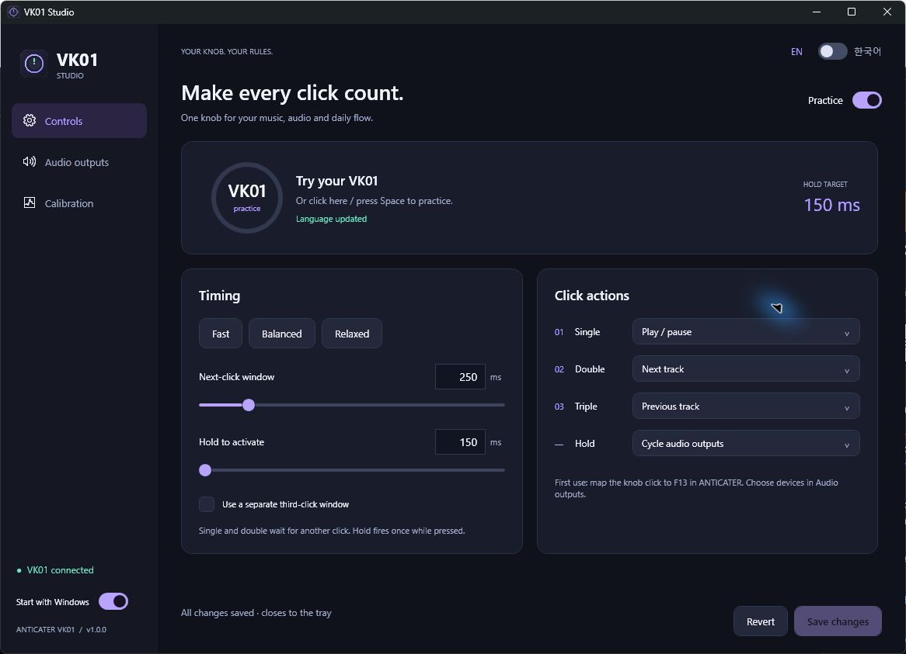

<p align="center"></p>
<h1 align="center">VK01 Studio</h1>
<p align="center"><strong>Custom Windows software for the ANTICATER VK01 volume knob</strong><br>Your music. Your audio outputs. One knob.</p>
<p align="center">
 <a href="README.md"></a>
 <a href="https://github.com/kwon1h/anticater-vk01-studio/releases/latest"></a>
</p>

<p align="center"></p>
<p align="center"><strong>Made for this knob — ANTICATER VK01 / VK-01</strong><br>The desktop volume controller with a rotary knob, square base and RGB lighting.</p>



**VK01 Studio** adds single, double, triple and hold gestures to the ANTICATER VK01 / VK-01 rotary volume controller. Map media keys, cycle between speakers, headphones and USB DACs, and measure your own timing in a consistent dark desktop UI.

English is the default language. Switch instantly between **English and Korean** at the top right. No extra driver, Python or Node.js is required.

## Features

- Independent single / double / triple / hold actions: play/pause, next/previous track, audio output cycle, mute or no action.
- Adjustable click windows (120–1,000ms) and hold threshold (150–3,000ms); optional independent third-click window.
- Hold fires once at the threshold while the button is still down. No extra action on release.
- Native Windows output enumeration, user-defined cycle order and automatic refresh; disconnected outputs are skipped.
- Live progress, safe practice mode, labeled measurement history and timing suggestions.
- Start-with-Windows switch, tray operation and a custom multi-resolution app icon.

## Quick start

1. Download `VK01Studio-v1.1.0-win-x64.zip` from [Releases](https://github.com/kwon1h/anticater-vk01-studio/releases/latest) and extract it to a **permanent folder**.
2. Connect the VK01 over USB. In the **[ANTICATER setup utility](https://anticater.com/pages/download), map the knob click to `F13` and save it to the device**. Keep your existing rotation mappings.
3. Run `VK01Studio.exe`. Open **Audio outputs**, check at least two playback devices and arrange their cycle order. Optionally include the communications role.
4. Click **Save changes**. Disable **Practice** or close the settings window to enable real gestures.
5. Enable **Start with Windows** at the bottom left if desired. Language and startup changes save immediately.

> The settings window opens in **practice mode**. Closing the window keeps the app in the tray and resumes saved actions. Use **Exit** in the tray menu to quit completely.

| Gesture | Default action |
|---|---|
| Single | Play / pause |
| Double | Next track |
| Triple | Previous track |
| Hold | Cycle selected audio outputs |

New profiles use a **320ms click window** and **600ms hold**. Existing saved timing is preserved.

## Using the supplied 2.4 GHz USB receiver

The receiver supports **single, double, triple and hold** gestures. The tested receiver did not forward F13 or F12 click mappings, so receiver mode uses a separate consumer-control input.

1. Connect the knob in 2.4 GHz mode.
2. In the [ANTICATER setup utility](https://anticater.com/pages/download), map the **center click → Media → Treble +**, then **Save**. Keep rotation mappings unchanged.
3. In VK01 Studio, select **Controls → Knob input → 2.4 GHz receiver · Treble +** and **Save changes**.
4. Test in practice mode, then disable practice or close settings.

Real press/release reports preserve hold duration, so hold fires at your configured threshold before release. Input mode is saved on the PC. To return to F13, change both the vendor mapping and VK01 Studio input mode. Direct Bluetooth pairing remains unverified.

## Your audio cycle


Active playback devices refresh approximately every 2 seconds. Check the outputs to include and use the arrows to arrange them. If the current Windows default is outside the selection, cycling starts at the first selected device. Disconnected devices remain in the saved order and are skipped until reconnected.

**Test cycle now changes the real Windows output even in practice mode.** Console and multimedia defaults change together; communications is optional. Applications pinned to a specific endpoint may keep using that endpoint.

## Timing and calibration

Single waits for a possible second click; double waits for a possible third. A window runs **from the previous release to the next press**. Triple commits on the third release. Hold uses its own threshold and fires while pressed. Press-and-rotate cancels a gesture that has not yet committed.

In **Calibration**, choose **Single**, perform one click on the real VK01, then repeat with **Double**, **Triple** and **Hold**. Complete each trial within 12 seconds. Repeat a few times, select **Suggest my timing**, practice and save. Only labeled physical VK01 measurements train suggestions; mouse/Space simulations are excluded.

Suggestions add a 60ms margin to the 95th-percentile click gap and a 200ms margin to short presses, with bounded heuristic defaults. Timing starts when Windows receives input, so it cannot measure internal firmware latency or the moment your finger touches the knob.

## Compatibility and persistence

- Windows 10 / 11 **x64**, **.NET Framework 4.8+**. Tested on Windows 10; a separate Windows 11 hardware test is pending.
- Targets wired USB and the supplied 2.4 GHz receiver at `VID_05AC / PID_022C / MI_01`. Identical VID/PID devices can also match. Other revisions and direct Bluetooth pairing are unverified.
- The **F13 or Treble + click mapping** resides on the device. Input mode, gestures, actions and endpoint choices are stored **on the PC** and require VK01 Studio to be running.
- Settings, up to 80 recent measurements and diagnostic logs live in `%LOCALAPPDATA%\VK01Studio`. No telemetry or network upload functionality is implemented.
- Autostart uses the current user's `HKCU\Software\Microsoft\Windows\CurrentVersion\Run` entry. Re-enable it from the new location after moving the app.
- This is an **unofficial community project**, not a firmware replacement or a vendor ANTICATER product.

## Build

```powershell
git clone https://github.com/kwon1h/anticater-vk01-studio.git
cd anticater-vk01-studio
.\scripts\build.ps1 -Test
```

Builds with the Windows .NET Framework C# compiler and WPF assemblies; no NuGet packages. Output: `build\VK01Studio.exe`. The build requires the .NET Framework 4.8 WPF APIs.

`src/` holds input, gestures, native audio and WPF UI; `tests/` covers gesture detection, settings and cycle order; `assets/` contains original icons; `scripts/` builds and packages; `docs/` explains architecture and validation. Personal settings, input traces, measurement history and vendor binaries are excluded. See [architecture and validation](docs/architecture.md).
