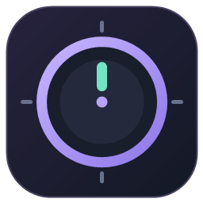
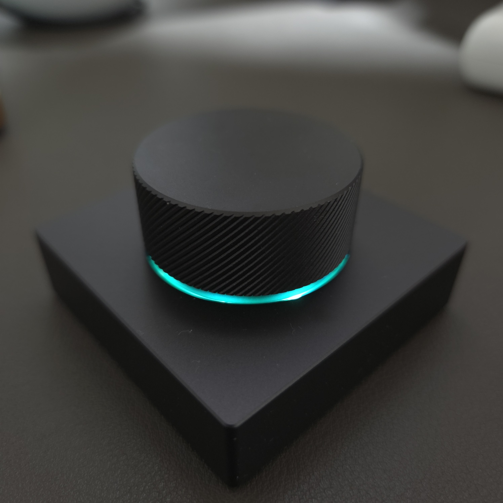
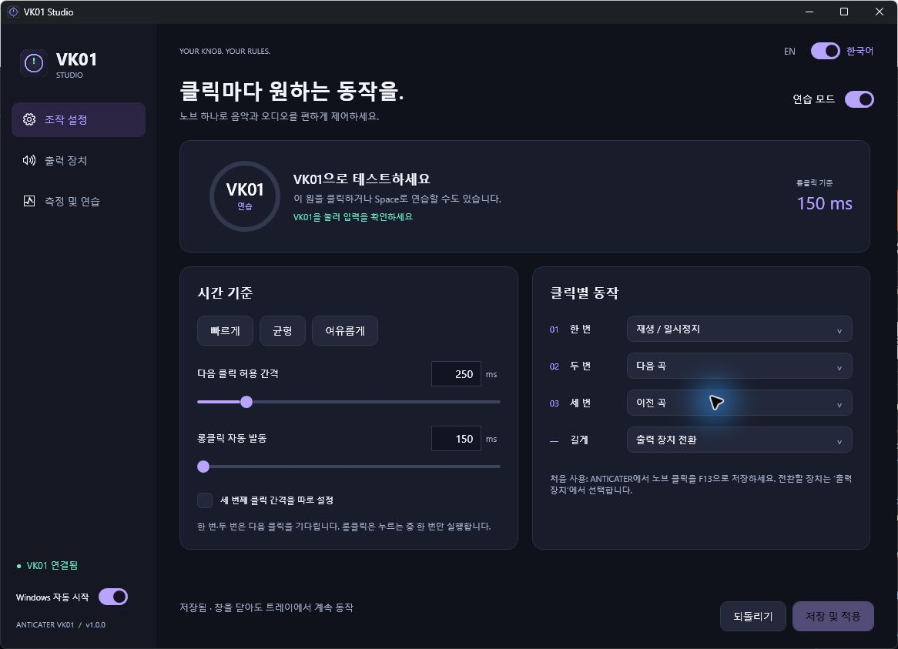
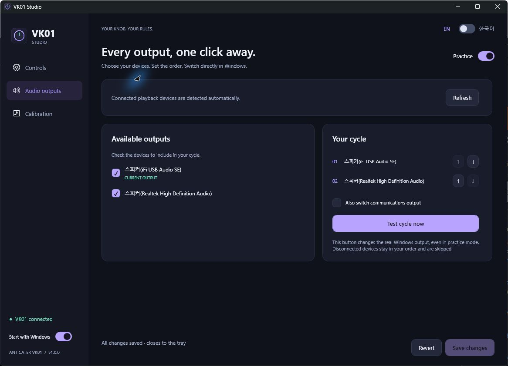

<p align="center"></p>
<h1 align="center">VK01 Studio</h1>
<p align="center"><strong>ANTICATER VK01을 위한 Windows 커스텀 소프트웨어</strong><br>노브 하나에 음악 제어와 출력 장치 전환까지.</p>
<p align="center">
 <a href="README.en.md"></a>
 <a href="https://github.com/kwon1h/anticater-vk01-studio/releases/latest"></a>
</p>

<p align="center"></p>
<p align="center"><strong>이 노브를 위한 앱입니다 — ANTICATER VK01 / VK-01</strong><br>사각 베이스 위 회전 노브와 RGB 조명이 있는 데스크톱 볼륨 컨트롤러입니다.</p>



## 클릭마다 원하는 동작을

**VK01 Studio**는 안티케이터 ANTICATER VK01 / VK-01 볼륨 노브에 싱글·더블·트리플·롱클릭을 더하는 커뮤니티 앱입니다. 재생 제어, 스피커·헤드폰·USB DAC 전환, 클릭 시간 측정을 하나의 다크 UI에서 설정합니다. 영어가 기본 언어이며 우상단 토글로 한국어를 바로 선택할 수 있습니다.

| 기능 | 할 수 있는 일 |
|---|---|
| 클릭별 동작 | 재생/일시정지, 다음 곡, 이전 곡, 출력 전환, 음소거, 동작 없음 |
| 내 손에 맞는 시간 | 클릭 간격 120–1,000ms, 롱클릭 150–3,000ms; 세 번째 클릭 간격도 별도 설정 |
| 즉시 롱클릭 | 누름 기준 시간에 도달하면 한 번 실행; 뗄 때 중복 실행 방지 |
| 출력 장치 직접 전환 | Windows Core Audio로 자동 인식; 선택한 장치만 원하는 순서로 반복 |
| 연습과 측정 | 실제 동작 없이 연습, 실시간 진행 표시, 의도와 판정 비교, 측정값 기반 추천 |
| 로그인 시 실행 | 화면 왼쪽 아래 자동 시작 스위치; 관리자 권한 불필요 |
| 한글 / 영어 | 전체 설정 화면과 트레이 메뉴 전환, 선택한 언어 기억 |

별도 드라이버·Python·Node.js가 필요하지 않습니다.

## 빠른 시작

1. [최신 릴리스](https://github.com/kwon1h/anticater-vk01-studio/releases/latest)에서 Windows x64 ZIP 파일을 받아 **고정해서 사용할 폴더**에 압축을 풉니다.
2. VK01을 USB로 연결합니다. **[ANTICATER 설정 프로그램](https://anticater.com/pages/download)에서 노브 클릭을 `F13` 키로 지정하고 장치에 저장**합니다. 볼륨 회전 설정은 그대로 둘 수 있습니다.
3. `VK01Studio.exe`를 실행합니다. 영어 UI 우상단의 `EN / 한국어` 토글로 언어를 바꿀 수 있습니다.
4. **출력 장치 / Audio outputs**에서 전환할 장치 두 개 이상을 체크하고 순서를 정합니다. 필요하면 통신용 기본 출력도 함께 전환하도록 설정합니다.
5. **저장 및 적용 / Save changes**를 누릅니다. 저장된 설정은 실제 동작에 적용됩니다.
6. 자동 실행이 필요하면 왼쪽 아래 **Windows 자동 시작 / Start with Windows**를 켭니다. Windows 시작 앱에서도 VK01 Studio가 켜져 있어야 합니다.

> 시작할 때와 설정 창을 열 때는 저장된 설정으로 실제 동작합니다. 실제 동작 없이 시험하려면 **연습 모드**를 켜세요. 설정 창을 닫으면 트레이에서 계속 동작합니다. 완전히 종료하려면 트레이 메뉴의 **종료 / Exit**를 선택하세요.

기본 클릭 간격은 320ms, 롱클릭은 600ms입니다. 기존 사용자의 저장된 시간은 유지됩니다.

| 입력 | 기본 동작 |
|---|---|
| 한 번 클릭 | 재생 / 일시정지 |
| 두 번 클릭 | 다음 곡 |
| 세 번 클릭 | 이전 곡 |
| 길게 누르기 | 선택한 출력 장치 순환 |

## 동봉된 2.4GHz USB 수신기로 사용하기

수신기에서도 **싱글·더블·트리플·롱클릭**을 사용할 수 있습니다. 테스트한 수신기는 F13·F12 클릭 매핑을 PC에 전달하지 않아, 별도의 미디어 입력을 사용합니다.

1. 노브를 2.4GHz 모드로 연결합니다.
2. [ANTICATER 설정 프로그램](https://anticater.com/pages/download)에서 **가운데 클릭 → Media → Treble +**를 선택하고 **Save**합니다. 회전 설정은 그대로 둡니다.
3. VK01 Studio의 **조작 설정 → 노브 입력 방식**에서 **2.4GHz 수신기 · Treble +**를 선택하고 **저장 및 적용**합니다.
4. 연습 모드에서 확인한 뒤 연습을 끄거나 설정 창을 닫습니다.

수신기가 보내는 누름·뗌으로 길게 누르기도 판정하므로, 버튼을 떼기 전 설정한 시간에 동작합니다. 입력 방식은 PC에 저장됩니다. F13 방식으로 돌아가려면 전용 앱과 VK01 Studio의 설정을 함께 바꾸세요. Bluetooth 직접 연결은 아직 검증하지 않았습니다.

## 출력 장치를 내 방식으로



연결된 **재생 출력 장치**를 약 2초마다 자동 갱신합니다. 목록의 체크박스로 전환 대상에 포함하고, 오른쪽 화살표로 순서를 바꿉니다. 현재 선택 목록 밖의 장치가 기본 출력이면 첫 번째 선택 장치부터 시작합니다. 연결이 끊긴 장치는 저장된 순서에 남고 전환할 때 건너뜁니다. 다시 연결하면 해당 순서로 복귀합니다.

**지금 전환 테스트 / Test cycle now**는 연습 모드에서도 실제 Windows 출력을 바꿉니다. 일반 재생·시스템 출력을 함께 전환하며, 통신용 출력은 별도 체크박스로 포함합니다. 특정 장치를 직접 지정해서 사용하는 앱은 자체 출력 설정을 따를 수 있습니다.

## 클릭 판정과 개인화

싱글은 두 번째 클릭을, 더블은 세 번째 클릭을 기다린 뒤 확정합니다. 간격은 **앞 클릭을 뗀 시점부터 다음 클릭을 누른 시점까지**입니다. 세 번째 클릭은 뗄 때 즉시 확정하고, 롱클릭은 별도의 누름 기준에 도달하는 순간 실행합니다. 노브를 누른 채 회전하면 아직 확정되지 않은 판정을 취소합니다.

**측정 및 연습 / Calibration**에서 `한 번 → 실제 노브 한 번`, `두 번 → 실제 노브 두 번`, `세 번 → 실제 노브 세 번`, `길게 → 실제 노브 길게` 순서로 측정합니다. 각 버튼을 누른 뒤 12초 안에 동작하세요. 여러 번 반복한 다음 **측정값으로 추천**을 누르고 연습 후 저장합니다. 추천은 의도가 지정된 실제 VK01 측정만 사용합니다. 화면 마우스 연습은 추천에 쓰지 않습니다.

추천은 표본의 클릭 간격 95백분위에 60ms, 짧은 누름에 200ms 여유를 더하는 휴리스틱입니다. 측정 시간은 Windows가 첫 입력을 받은 시각 기준이며, 기기 내부 지연과 손가락이 실제로 닿은 시각은 포함하지 않습니다.

## 호환성과 저장 방식

- Windows 10 / 11 **x64**, .NET Framework **4.8 이상**. Windows 10에서 검증했습니다. Windows 11의 별도 실기 검증은 아직 없습니다.
- 유선 USB와 동봉 2.4GHz 수신기의 `VID_05AC / PID_022C / MI_01` 인터페이스를 대상으로 합니다. 같은 VID/PID를 쓰는 다른 기기를 함께 연결한 경우 주의하세요. 다른 하드웨어 리비전과 Bluetooth 직접 연결은 검증되지 않았습니다.
- VK01에는 **F13 또는 Treble + 클릭 매핑**이 저장됩니다. 입력 방식·다중 클릭·긴 누름·동작·전환 장치 설정은 **PC에 저장되며 앱이 실행 중일 때 적용**됩니다.
- 설정·최근 측정(최대 80개)·진단 로그는 `%LOCALAPPDATA%\VK01Studio`에 보관합니다. 네트워크 전송이나 사용량 수집 기능은 없습니다.
- 자동 실행은 현재 사용자 `HKCU\Software\Microsoft\Windows\CurrentVersion\Run` 항목으로 등록됩니다. 앱을 이동했다면 새 위치에서 자동 시작을 다시 켜세요.
- 공식 ANTICATER 앱·펌웨어를 대체하지 않습니다. ANTICATER 제조사와 무관한 비공식 프로젝트입니다.

## 직접 빌드

```powershell
git clone https://github.com/kwon1h/anticater-vk01-studio.git
cd anticater-vk01-studio
.\scripts\build.ps1 -Test
```

추가 패키지 없이 Windows 기본 .NET Framework C# 컴파일러로 빌드합니다. 결과는 `build\VK01Studio.exe`입니다. 이 빌드는 .NET Framework 4.8의 WPF API를 사용합니다.

```text
src/       입력·클릭 판정·Core Audio·WPF UI
tests/     클릭 / 설정 / 출력 전환 순서 테스트
assets/    직접 제작한 SVG·PNG·ICO 아이콘
scripts/   아이콘 생성과 빌드 / 패키징
docs/      실제 앱 화면과 구현 설명
```

원시 입력 로그, 개인 설정, 측정 기록, ANTICATER 바이너리는 저장소와 배포 ZIP에 포함하지 않습니다. [구현 설명과 검증](docs/architecture.md)을 참고하세요.
